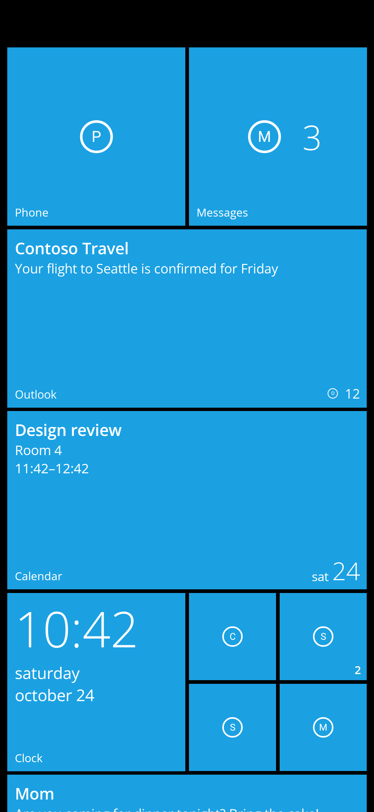
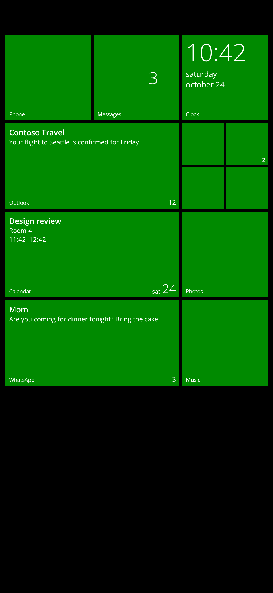
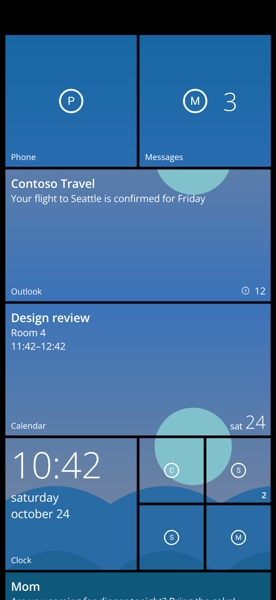
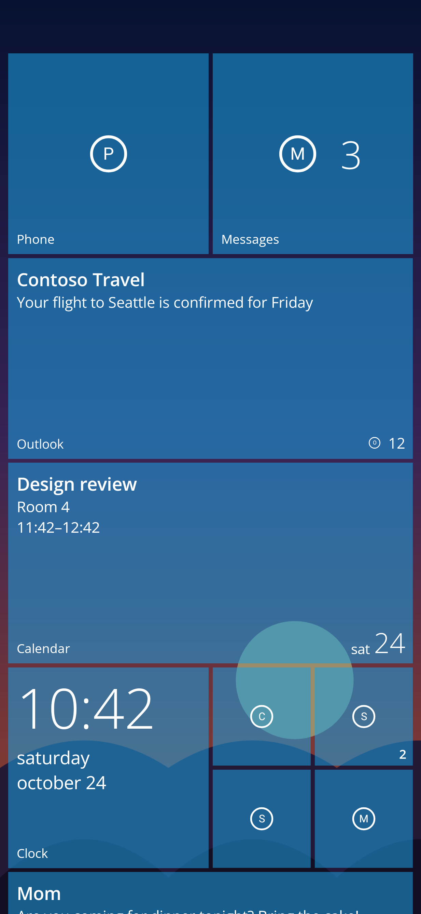

# Metro Launcher

A Windows Phone–style home screen for Android 12+ with live tiles, built to cost essentially
no battery.

| Classic (4 columns) | Show more tiles (6 columns) |
|---|---|
|  |  |

| Photo tiles | Full photo |
|---|---|
|  |  |

*Rendered on the JVM by `StartScreenshotTest` (placeholder icons; real apps use their themed icons).*

## Features

- **Start screen**: small, medium, wide and large tiles; small tiles cluster in 2×2 blocks
  like Windows Phone. Press and hold a tile to edit: drag to move, ⊗ to unpin, ↘ to resize.
- **App list**: swipe left. Alphabetical with letter tiles; tap a letter for the jump grid.
  Search at the top. Press and hold an app to pin, uninstall or open app info.
- **Live tiles**:
  - Any app: unread count, and the tile flips to show the latest message (from notifications).
  - Clock app: time and date, flips to the next alarm.
  - Calendar app: next appointment and today's date.
- **Theme**: dark/light/system background, the 20 Windows Phone accent colours, themed
  (monochrome) app icons on Android 13+, tilt-on-press effect.
- **Start background**: solid, Windows Phone 8.1 "photo tiles" (each tile is a window onto one
  photo), Windows 10 Mobile full-screen photo with parallax, or the system wallpaper. A tile
  transparency slider and an "accent colour from my background" option go with them. The photo
  comes from the system photo picker, so no media permission is needed.
- **App list**: a "recently added" group (up to 3 apps from the last 5 days) above the letters.
- **Settings**: "Metro settings" in the app list. Also sets Metro as the default home app.

## Battery design

- No background service of our own, no wake locks, no alarms, no polling.
- Notification counts come from a `NotificationListenerService` that the system calls only
  when a notification is posted or removed.
- The clock ticker, calendar queries and tile flip animations run only while the start
  screen is in the foreground (`collectAsStateWithLifecycle` / `repeatOnLifecycle`), and
  only for tiles that need them and are visible.
- Black background by default (OLED pixels off); opaque window, no wallpaper compositing
  unless the "wallpaper" start background is chosen. Photo backgrounds hold one downsampled
  bitmap and animate nothing: parallax is a draw-only offset of the scroll position.
- Icons are rendered once and cached in memory.

## Building

Requires JDK 17+ and the Android SDK (platform 36).

```sh
./gradlew assembleDebug          # app/build/outputs/apk/debug/app-debug.apk
./gradlew testDebugUnitTest      # unit tests + screenshots in app/build/outputs/roborazzi/
```

## Publishing notes (Google Play)

- `minSdk 31` (Android 12), `targetSdk 36`.
- Uses `<queries>` for launchable apps instead of `QUERY_ALL_PACKAGES`.
- Notification access is opt-in, with an in-app explanation (Play's prominent-disclosure
  requirement); data never leaves the device. Add the same statement to the privacy policy
  and Data safety form.
- No SMS or call-log permissions (Play restricts them to default SMS/dialer apps); message
  tiles work through notifications instead.
- Fonts: Segoe is proprietary, so Open Sans (SIL OFL; Light, Regular and SemiBold in
  `res/font`, licence in `assets/licenses`) is bundled instead.
- Don't use "Windows" or Microsoft logos in the store listing.

## Roadmap

- Weather tile (Open-Meteo via WorkManager, 30–60 min), photo and music tiles
- Turnstile page animations
- Pinned shortcuts from apps (Android's version of secondary tiles)
- Hosting Android widgets inside tiles, icon packs, tile folders
