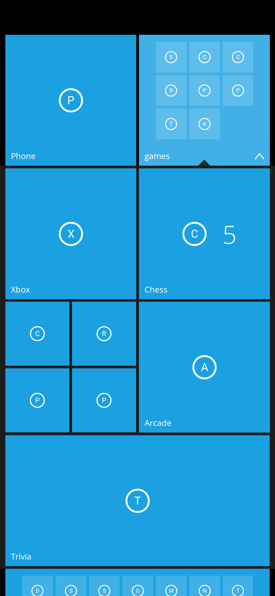
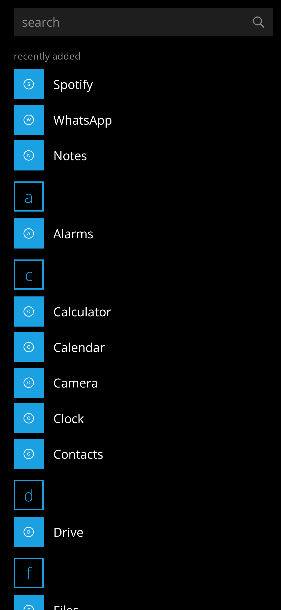
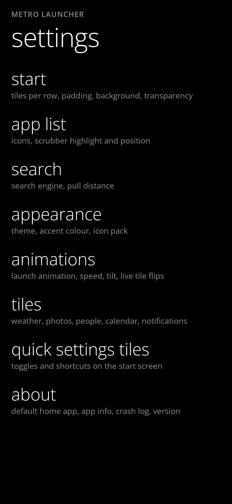
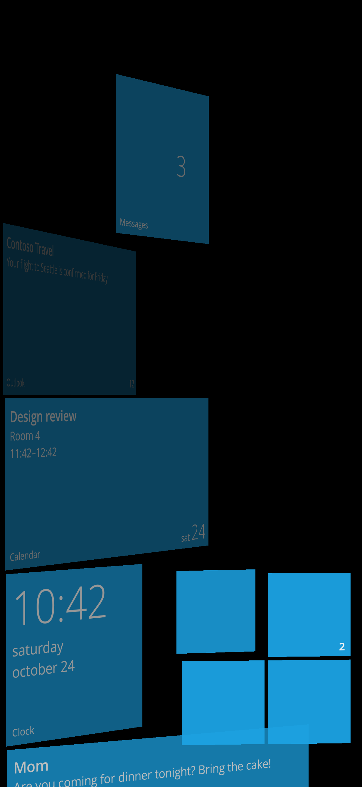
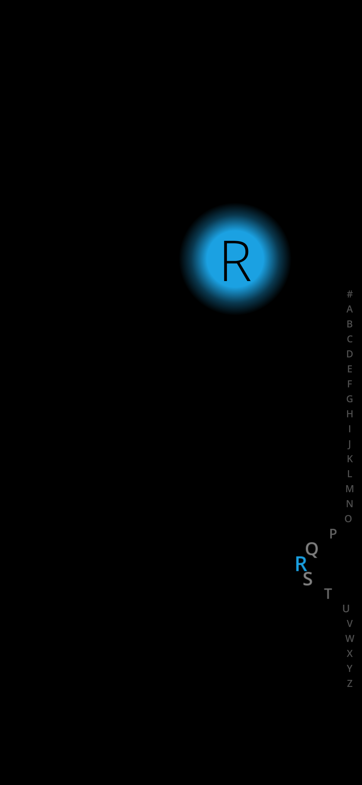
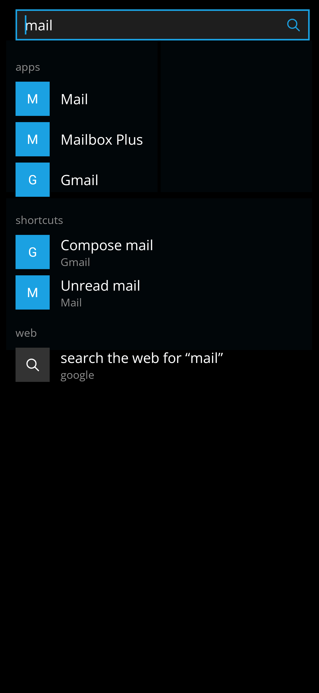
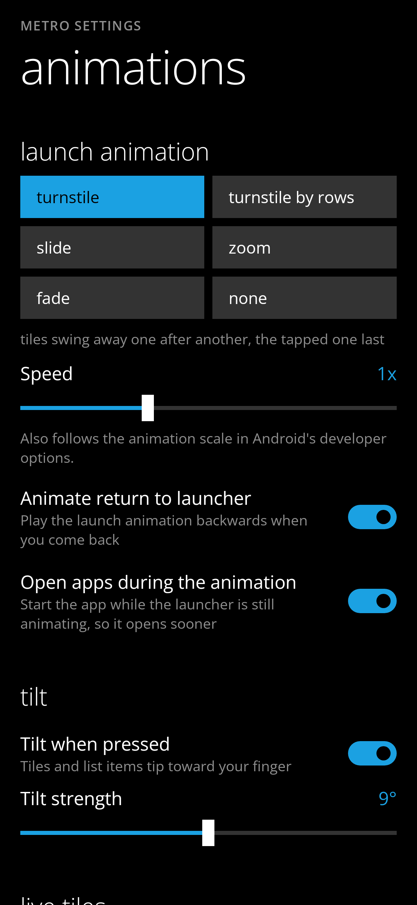

# Metro Launcher

A Windows Phone / Windows 10 Mobile style home screen for Android 12+ (Kotlin, Jetpack Compose).
Live tiles, folders, photo backgrounds and turnstile animations, built to cost almost no battery.

| Start | Photo through tiles | Full photo |
|---|---|---|
|  |  |  |

| Folder open | App list | Settings |
|---|---|---|
|  |  |  |

| Turnstile launch | Alphabet scrubber | Search |
|---|---|---|
|  |  |  |

| Animation settings |
|---|
|  |

*Rendered on the JVM by the `*ScreenshotTest` classes with placeholder icons; on a phone, tiles show each app's own icon.*

## Features

**Start screen**
- Small, medium, wide and large tiles; small tiles cluster in 2x2 blocks like Windows Phone. Four columns, or six with "Show more tiles".
- Tablets and unfolded foldables: tiles keep about a phone's size and, by default, the number of tiles per row ("auto") follows the width so the grid fills the screen edge to edge, also after rotating or folding; the app list sits in the middle of the screen. Settings also offer four, six or eight tiles per row there.
- Tiles keep the place you give them and only ever slide straight up into free space, never sideways into gaps; resizing or dropping a tile pushes the ones in its way down. Any tile can rise one row into a row left half empty, such as under a pair of small tiles. New tiles go at the bottom.
- Press and hold a tile to edit: drag to move (dragging never makes a folder), the corner badges unpin, resize or group into a folder. Back, Home or a tap on empty space leaves edit mode.
- "+" under the tiles adds weather, photos, people, widget and Metro Plus tiles (quick settings and assistant); the arrow opens the app list. Settings can tint these buttons ("+", magnifier, arrow) in the accent colour.
- Padding is adjustable on all four edges (top, bottom, left, right). TalkBack gets custom actions (open folder, group into folder, remove from folder, unpin, resize) as an alternative to dragging.

**Tiles and live tiles**
- App tiles show an unread count and flip to the latest message (read from notifications). Clock and calendar apps show time, date, alarm and next appointment. Music apps show the current track and album art.
- Weather tile: current conditions, flipping to high/low and the next days. Location by city search or approximate device location.
- Photos tile (slideshow of photos you pick) and People tile (mosaic of contact photos).
- Shortcut tiles: apps' pinned shortcuts, from the app list menu or an app's own "pin shortcut" request.
- Widget tiles: Android app widgets hosted inside a tile, from the "widgets" picker (with search) or an app's pin request. Taps, buttons and scrolling lists work in place. In edit mode a widget tile gets a settings badge (when the widget has settings), a badge that shows it on the accent tile or without a tile background, and a corner handle you drag to resize it in whole cells, within the sizes its provider allows (TalkBack: make wider, narrower, taller, shorter).
- Live tiles flip one at a time, only while visible.
- A soft fade under the status bar keeps the clock and icons readable when tiles scroll up behind them (start screen and app list).

**Folders**
- Grouping is its own action, so moving tiles stays easy. In edit mode the selected app, shortcut or folder tile has a folder badge in its top left corner; tap it to start grouping. Tap other app and shortcut tiles to tick their round checkbox (the rest dim), then "create folder (n)" in the bar at the bottom, or "add to folder (n)" when you started from a folder. The new folder takes the first tile's place and children in the order you ticked them. "cancel", Back, Home or a tap on empty space leaves grouping.
- Tap a folder to open it inline below its row; drag children to reorder or out of the band to remove them. Folders with fewer than two children dissolve.
- Rename in edit mode by tapping the name strip of the folder tile. Folder tiles can be resized like other tiles.

**App list**
- Swipe left. Alphabetical with letter tiles and a jump grid, search, and a "recently added" group. The "plain icons" option shows bare icons instead of icons on accent squares.
- Alphabet scrubber on the right edge: the letters bulge in a wave around your finger. The big letter has a highlight (circle, rounded rectangle or none), shown either at a fixed spot at eye level or beside the finger, and a slider moves the scrubber up from the bottom edge.
- Press and hold an app for pin to start, app shortcuts, uninstall and app info.

**Search**
- Pull down on the start screen, or tap the magnifier under the tiles. Search opens when you release, ignores sideways pulls and gives a haptic tick at the threshold; the pull distance is adjustable. Swipe up or press Home to close it. Results appear as you type: apps, app shortcuts (when Metro is the default home app) and a web row that opens google, bing or duckduckgo (settings) in your default browser. A typed address gets an "open" row. Smarter app matching is free: initials ("yt" finds YouTube, "gm" Google Maps), small typos (one slip for 4 to 7 letters, two from 8), and matches inside words, ranked exact, prefix, word start, initials, contains, typo. Metro Plus adds smart search (below). Search or Enter opens the answer of a calculator or quick action when there is one, else the best app match, else the web search.
- Search results follow the app list's icon style, so "plain icons" applies there too.
- Metro makes no network requests while you type; nothing leaves the phone until you open a web result, and then your browser does it.

**Metro Plus** (one paid pack: quick settings tiles, assistant, smart search)
- A one-time Google Play purchase (Play product id `tiles_quick_settings`, unchanged), always unlocked in debug builds; locked tiles show "unlock to use". Add tiles from "+" under the tiles; settings has a "metro plus" page with three sections: "quick settings tiles", "assistant" and "smart search".
- *Quick settings tiles.* Kinds: flashlight, do not disturb, ringer (ring, vibrate, silent), auto-rotate, brightness (auto, 25%, 50%, 100%), wi-fi, mobile data, bluetooth, airplane mode, location, hotspot and battery. Larger tiles show extra detail such as signal bars, carrier or charge state.
- Tapping flashlight, do not disturb, ringer, auto-rotate and brightness changes the setting in place (the first tap on do not disturb or silent, or on brightness or auto-rotate, opens the system screen where you grant do not disturb access or "modify system settings"). Android doesn't let apps toggle Wi-Fi, mobile data or Bluetooth directly, so those open the system panel or settings page; airplane mode, location, hotspot and battery open their settings pages.
- Opt-in extras, off by default: the Wi-Fi network name (needs precise location) and connected Bluetooth devices (needs nearby devices permission).
- *Assistant.* One tile that follows the shared assistant choice: the app's icon and unread count, the latest reply (conversation title over the reply text, read from its notifications; the last message of a MessagingStyle notification is preferred and SECRET notifications are never shown), a "you asked: ..." footer, and a flip to the last question you asked from search. A notification titled with just the app's name shows the reply text only. Tap opens the assistant app; with no assistant chosen it shows "choose an assistant in settings". Nothing is polled: it reacts to notification changes. When the notification is gone (opened or dismissed) the tile keeps the assistant's last reply, dimmed and with a relative time ("2h ago") instead of an unread count; "clear last reply" in the metro plus page deletes it, as do changing the assistant or turning notification access or previews off.
- *Smart search.* Each feature has its own switch in settings, "search", "smart search"; while Metro Plus is locked none shows in results and that page lists them all with a lock and an "unlock with Metro Plus" button. Free forever: plain app-name search, the web row, the typed-address "open" row and smarter app matching.

**Smart search features** (Metro Plus; default in brackets)
1. Calculator and units [on]: + - * / ^ % and brackets, "15% of 2400", comma or point decimals, and offline unit conversion (length, mass, temperature, volume, speed, area, time, data) such as "5 km in miles", "70 f in c", "2.5 kg to lb". No currency. The answer is the top row; tap copies it.
2. Phone settings shortcuts [on]: keywords such as wifi, bluetooth, battery, display, sound, storage, location, date, language, hotspot, nfc, do not disturb, about phone lead to that page of the system settings; only pages that exist on the phone show (developer options only when enabled).
3. Quick actions [on]: "timer 5 min", "timer 90s", "alarm 7:30" or "alarm 6am" (opens the clock app to confirm), "note buy milk" (share to a notes app). "call <name>" and "message <name>" are handed to contacts search (feature 8, needs it switched on) and show the matching contacts that have a number.
4. Smarter app matching: free, see Search.
5. Suggestions before typing [on]: with nothing typed, your most used apps and the last eight searches, with "clear history". Launch counts and searches are stored on the phone only and left out of backups.
6. Calendar events [off; switching on asks for the calendar permission]: events in the next 30 days whose title or place matches, with when and where; tap opens the event in your calendar app.
7. Launcher actions [on]: "wallpaper", "edit tiles" or "edit start", "Metro settings", "smart search settings", "app info <app>", "uninstall <app>".
8. Contacts [off; asks for the contacts permission]: matches by name (initials and typos too) or by number, with the photo. Tap opens the contact; round buttons call (opens the dialler, nothing is dialled for you), message, and WhatsApp (only for contacts that have a WhatsApp account on the phone).
9. WhatsApp chats and groups [on]: matches WhatsApp's and WhatsApp Business's conversation shortcuts (including the cached ones Android keeps for older chats) by name; tap opens the chat. A chat the "shortcuts" section already lists is not listed twice. Needs Metro as the default home app; the settings row says so when it is not.
10. Search in apps [YouTube and Play Store on; Maps, Spotify, Amazon off]: rows "search <app> for '...'" below the web row, each with its own switch in settings under "search in apps", plus a list of other installed apps that accept a search (off until you switch them on). YouTube and Amazon fall back to their website in the browser when the app is not installed; Amazon uses the store for the SIM country, else the network country, else the language region (amazon.in, .co.uk, .de ...), default amazon.com. Only apps that can answer show.
11. Ask assistant [on]: the "ask <assistant>" row after the web row, below.
Contacts and calendar are only read while you search with their switch on and the permission granted; without the permission they show nothing.

**Ask an assistant** (Metro Plus, no APIs)
- Pick the assistant in the metro plus page, "assistant": off, one of the installed known apps (Claude, ChatGPT, Gemini, Perplexity, Copilot) or "other app" (any launchable app that accepts shared text). Until you choose, Claude is used if installed, else the first installed known assistant, else it stays off. The row has its own switch under smart search.
- Typing a query adds an "ask <app>" row after the web row. Tapping it sends the question with a plain `ACTION_SEND` text/plain intent to that app; if the app can't take shared text, the question is copied to the clipboard, the app opens and a toast says "question copied". The last question is kept on the phone for the assistant tile.

**Backgrounds and personalisation**
- Theme: dark, light or follow system. The 20 Windows Phone accent colours.
- Start background: solid; photo tiles (each tile is a window onto one photo); full photo with parallax; or the system wallpaper.
- Settings are a menu of pages: start, app list, search, appearance, animations, tiles, metro plus and about.
- Tile transparency slider, and "accent colour from my background" for the photo modes.
- Themed (monochrome) app icons on Android 13+, and icon packs (ADW, Nova and Apex formats).
- "Metro settings" lives in the app list and also sets Metro as the default home app.

**Animations** (settings page "animations")
- Launch style: turnstile, turnstile by rows, slide, zoom, fade or none. The turnstile swings the visible tiles or rows about the left edge, the tapped one last, and they swing back on return. Skipped when system animations are off.
- Speed from 0.5x to 2x; it also follows the system animation scale. "Animate return" plays the animation backwards when you come back; "open apps during the animation" starts the app while the launcher is still animating, so it opens sooner.
- Tilt on press (on/off and strength), live tile flips (on/off and interval) and a subtle swing while paging between start and the app list (on/off).

**Accessibility**
- TalkBack custom actions on the alphabet scrubber and on tiles; sliders work with TalkBack; quick settings tiles announce on or off and the assistant tile reads app, unread count and latest reply title.
- Labels wrap at large font sizes, and text stays readable on light accent colours.

## Battery design

- No service of our own, no wake locks, no alarms, no polling. The only scheduled background work is the weather tile's WorkManager job: about hourly, only while a weather tile is pinned and a place is set, with a network and not on a low battery.
- Notification counts come from a `NotificationListenerService` the system calls only when a notification is posted or removed. Media sessions are watched only while the start screen is visible.
- Clock ticker, calendar queries, tile flips, slideshows and widget updates run only while the launcher is on screen (`collectAsStateWithLifecycle`, `repeatOnLifecycle`), and flips only for visible tiles. Device location is taken at most once an hour, only while a weather tile is shown.
- Black background by default (OLED pixels off) and an opaque window; the wallpaper is composited only in "wallpaper" mode. Photo backgrounds hold one downsampled bitmap and animate nothing: parallax is a draw-only offset.
- Icons are rendered once and cached. The turnstile is one frame callback per launch and return (about 280 ms at normal speed, scaled by the speed setting), drawing only; idle costs nothing.

## Permissions

| Permission | Why | When requested |
|---|---|---|
| `INTERNET` | Download the forecast and search places on Open-Meteo | Only used once a weather place is set |
| `ACCESS_COARSE_LOCATION` | Weather for "my location" (rounded to about 1 km, no continuous updates) | When you tap "use my location" in settings |
| `READ_CONTACTS` | Photos for the people tile; contact search results (smart search) | When you tap "show contacts on people tile", or turn on "contacts" in smart search, in settings. Read on the phone, never uploaded |
| `READ_CALENDAR` | Next appointment on the calendar tile; event search results (smart search) | When you tap "show appointments on calendar tile", or turn on "calendar events" in smart search, in settings. Read on the phone, never uploaded |
| `ACCESS_FINE_LOCATION` | Wi-Fi name on the quick settings Wi-Fi tile (Android hides it without precise location) | When you turn on "show Wi-Fi name" in metro plus settings |
| `BLUETOOTH_CONNECT` | Names of connected devices on the Bluetooth quick tile | When you turn on "show Bluetooth devices" in metro plus settings |
| `ACCESS_NETWORK_STATE`, `ACCESS_WIFI_STATE` | Read Wi-Fi and mobile data state for the quick settings tiles | Normal permissions, granted at install; read only while such a tile is shown |
| `WRITE_SETTINGS` | Auto-rotate and brightness quick tiles | Only when you tap one of those tiles; Metro opens the system "modify system settings" screen |
| `ACCESS_NOTIFICATION_POLICY` | Do not disturb and silent on the quick settings tiles | Only when you tap one of those tiles; Metro opens the system "do not disturb access" screen |
| `BILLING` (`com.android.vending.BILLING`, added by the Play Billing library) | The one-time Metro Plus purchase | Only when you choose to buy |
| `REQUEST_DELETE_PACKAGES` | "Uninstall" in the app list (the system still asks to confirm) | Only when you choose uninstall |
| Notification access (`BIND_NOTIFICATION_LISTENER_SERVICE`) | Counts, latest message and now-playing on tiles | You enable it in system settings from a button in Metro settings, after an in-app explanation |

Background and tile photos use the system photo picker, so no media permission is needed. Nothing else is requested, and `QUERY_ALL_PACKAGES` is not used: `<queries>` lists launchable apps, the `ACTION_SEND` text/plain intent (to find apps that take shared text for the assistant row) and the five known assistant packages, the system settings app (settings shortcuts), the clock app's `SET_ALARM`/`SET_TIMER` intents and the wallpaper picker (quick actions and launcher actions).

**Play Data safety notes:** contacts and calendar are read on the device to show search results and tiles and are never uploaded; recent searches and launch counts are stored locally (`search_history.xml`) and excluded from backup and device transfer; contact names, numbers and photos, calendar events and WhatsApp conversation shortcuts are queried on demand for the search results, held in memory for at most a minute and never uploaded; the search-in-apps rows send the typed text only to the app or website you tap; billing state is excluded too.

## Building

Requires JDK 17+ and the Android SDK (platform 36).

```sh
./gradlew assembleDebug        # app/build/outputs/apk/debug/app-debug.apk
./gradlew testDebugUnitTest    # unit tests; also compares screenshots with the goldens in app/src/test/screenshots/
./gradlew lintDebug
./gradlew assembleRelease bundleRelease
```

To refresh `docs/`, copy the PNGs you want from `app/src/test/screenshots/` (see Screenshot tests below).

## Screenshot tests

The `*ScreenshotTest` classes render screens on the JVM with Roborazzi (56 goldens covering the start screen, app list, search, launch animations and settings pages). A normal `testDebugUnitTest` run **verifies** each render against its golden image in `app/src/test/screenshots/` (1% change tolerance) and fails on a difference or a missing golden, so a new screenshot test must have its golden recorded and committed. Actual, reference and diff images for failures land in `app/build/outputs/roborazzi/` (uploaded as the `reports` artifact in CI).

After an intentional UI change, re-record and commit the updated PNGs:

```
./gradlew testDebugUnitTest --tests '*Screenshot*' -Proborazzi.record=true
```

## CI and releases

`.github/workflows/build.yml` runs tests, lint, a release APK and AAB on pushes to `master`, pull requests, `v*` tags and manual runs (changes that only touch docs are skipped), and uploads them with the lint and screenshot reports as workflow artifacts. Publishing a release (a `v*` tag or a manual run with `release_tag`) passes `-PrequireReleaseSigning=true`, which fails the build unless the signing secrets are set; other builds fall back to the debug key. The version name is `0.2.0-dev.<run>` on branches and the tag without its `v` on tags; the version code is the run number.

Pushing a `v*` tag (for example `git tag v0.3.0 && git push origin v0.3.0`) also publishes a GitHub release with `metro-launcher-<version>.apk` and `.aab` and generated notes. You can also publish from the Actions tab: run **Build** manually with a `release_tag` such as `v0.3.0`, and the workflow creates the tag on the built commit. A manual release stops early if that tag or release already exists, so pick a new version each time. It also skips tests and lint when a push build of the same commit already passed them.

Signing is optional. Add the repository secrets `KEYSTORE_BASE64` (base64 of the `.jks`), `KEYSTORE_PASSWORD`, `KEY_ALIAS` and `KEY_PASSWORD` to sign with your own key. Without them the release is signed with the debug key and marked as a prerelease: installable for testing, not accepted by Google Play.

## Crash log

If Metro crashes, the stack trace is saved to `last_crash.txt` in the app's private storage (the last four crashes, with time, app version, phone model and thread), and the system still gets the crash as usual. "last crash" in Metro settings shows it with "share" and "clear" buttons; nothing is sent anywhere unless you press share. Release builds are minified, so a trace needs the `mapping.txt` of the same build to read: it is in the AAB, and the CI `reports` artifact has it as `outputs/mapping/release/mapping.txt`.

## Publishing to Google Play

- `minSdk 31`, `targetSdk 36`. Upload the signed `.aab`.
- Privacy policy: `docs/privacy.html`, served by GitHub Pages from `master` `/docs` at https://danielphingston.github.io/metro-launcher/privacy.html.
- **Notification listener:** access is opt-in, with an in-app explanation (Play's prominent-disclosure rule). Notification content is used on the device only and never leaves it. The assistant tile's last reply (title, up to 2000 characters of text, time) is stored on the device only, in the app's no-backup storage, and is excluded from cloud backup and device transfer. Say so in the privacy policy and the Data safety form.
- **Location and weather:** the approximate location (rounded to about 1 km) and any city name you search for are sent to Open-Meteo, hourly while a weather tile is shown. Declare this in the Data safety form. Open-Meteo's data is CC BY 4.0 and requires attribution; credit it in the store listing.
- **Contacts and calendar:** read on the device to draw tiles and, if the user switches those smart search features on, to show search results; never uploaded. Declare the permissions and explain them in the listing.
- **In-app product and billing:** create a one-time, non-consumable in-app product with ID `tiles_quick_settings` in Play Console and activate it. Metro uses Play Billing, acknowledges the purchase and caches the owned state for offline use; until the product exists the buy button simply doesn't appear. Debug builds are always unlocked.
- **Precise location and nearby devices:** `ACCESS_FINE_LOCATION` and `BLUETOOTH_CONNECT` are opt-in, only for the Wi-Fi name and Bluetooth device info on quick settings tiles. Read on the device and never uploaded; declare them in the Data safety form and explain them in the listing. `WRITE_SETTINGS` and `ACCESS_NOTIFICATION_POLICY` are special access granted in system settings.
- **Photos:** the photo picker means no media permission and nothing to declare. Metro keeps only the URIs of photos you picked.
- **No `QUERY_ALL_PACKAGES`:** package visibility comes from `<queries>`, so no declaration is needed. There are no SMS or call-log permissions.
- Don't use "Windows" or Microsoft logos in the listing.

## Credits and licences

- Code: [MIT License](LICENSE).
- Font: [Open Sans](https://fonts.google.com/specimen/Open+Sans) (Light, Regular, SemiBold), SIL Open Font License 1.1, bundled in `res/font` with the licence in `assets/licenses`. Segoe is proprietary, so it is not used.
- Weather: [Open-Meteo](https://open-meteo.com/), data under CC BY 4.0.
- Not affiliated with Microsoft; the design is inspired by Windows Phone and Windows 10 Mobile.

## Known limitations

- Wallpaper mode sets the status bar icons from the wallpaper's own brightness hint; text on the page itself still follows the theme, so on a very bright or dark wallpaper some text can be hard to read. Android does not let apps read the wallpaper image, so the accent can't be taken from it.
- Only app and shortcut tiles can go into folders (not widgets, weather, photos or people), and folder children are at most wide.
- Widgets keep receiving updates while the app list is showing. A long-press on a widget that takes every touch (rare) enters edit mode, but the tile is then dragged with a second touch.
- A launcher can only animate its own window. The opened app's window gets a simple fade, slide or zoom, and the close animation is the system's; the launch style only changes how the launcher itself moves.
- Phones are portrait only. Notification access can be dropped by aggressive battery savers; set battery usage to "Unrestricted" if tiles stop updating.
- Weather needs a network and a manual place or location permission; there is no forecast for places Open-Meteo can't find.
